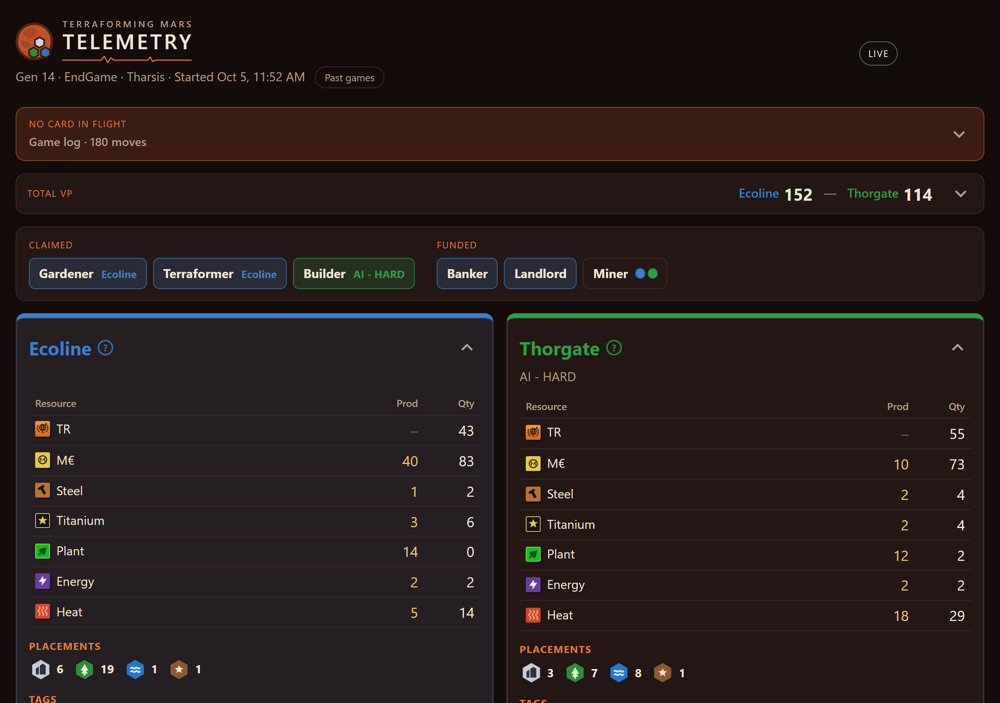
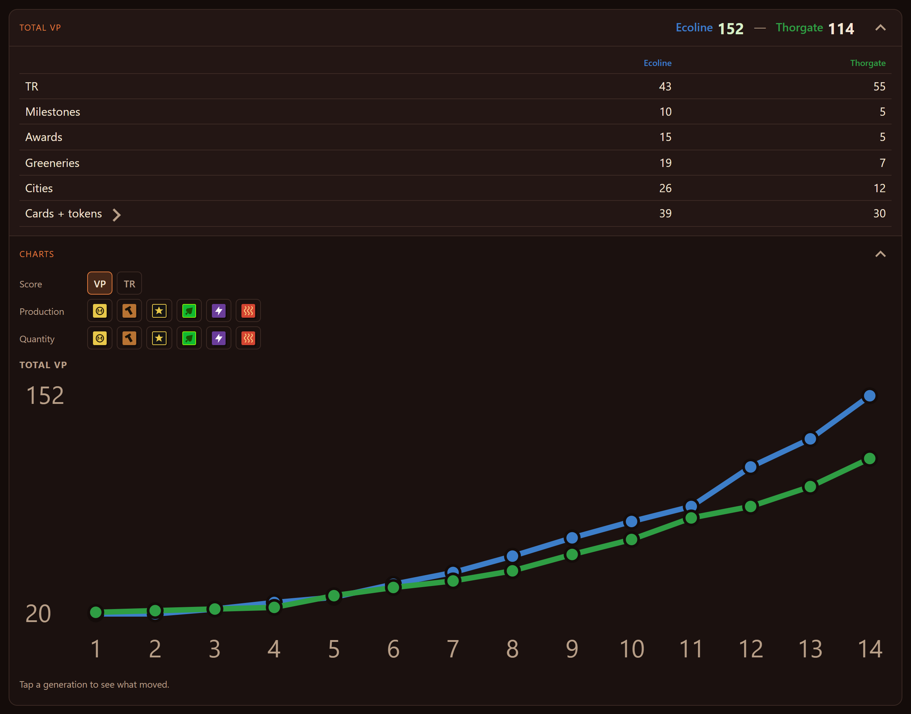
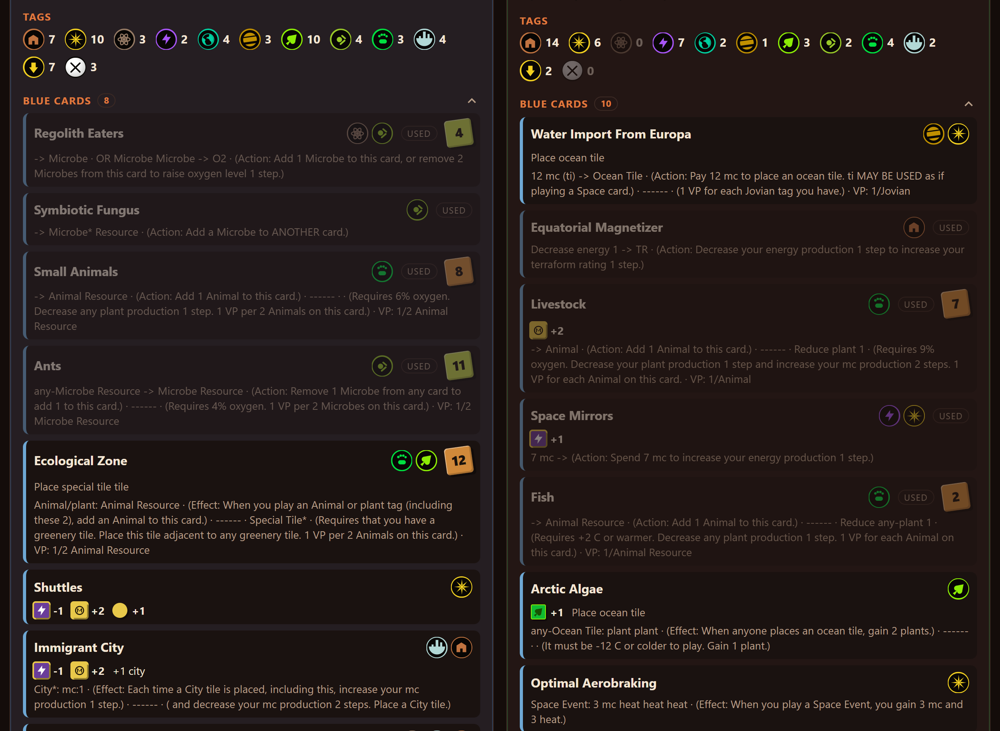
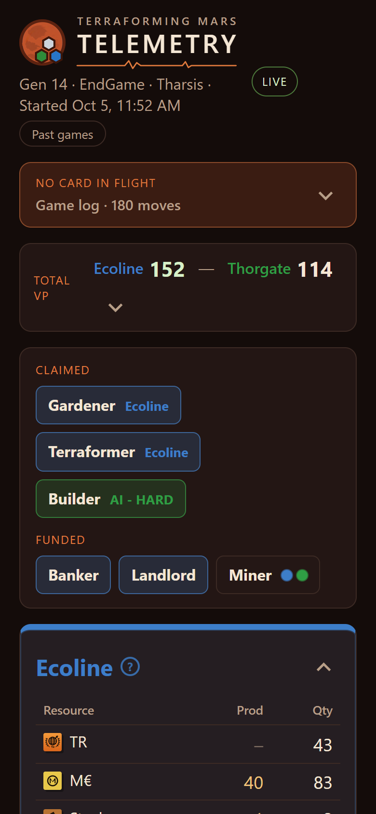

<p align="center">
  
</p>

<h1 align="center">Terraforming Mars Telemetry</h1>

<p align="center">
  <b>A live second-screen dashboard for the Terraforming Mars digital edition.</b><br>
  See every player's board at a glance, follow the score as it moves, and never miss a tile placement.
</p>

<p align="center">
  <a href="https://github.com/Villunus/terraforming-mars-telemetry/releases/download/latest/TerraformingMarsTelemetry-Setup.msi"><b>⬇ Download for Windows</b></a>
</p>

<p align="center">
  
</p>

While you play, Terraforming Mars Telemetry reads the game's local log and turns it into a live dashboard of
everything on the table. It shows every player's resources and production, tags, played cards, tiles,
milestones, awards and colonies, so you don't have to click through the game's menus to check an
opponent's board.

It works for games against the AI and against other people. Open it on a second monitor, or scan the QR
code to follow along on your phone.

Opponents' hands are never shown. The only hand you'll see is your own, on your board.

## Know the score before the game ends

The scoreboard shows what each player would score if the game ended now: TR, milestones, awards,
greeneries, cities and card points. Open the charts to see how the score, production and resources moved
each generation. Tap a generation to see what changed.

<p align="center">
  
</p>

## Every player's board in one place

Tags, blue cards with their actions and resources, automated cards and events for every player, so you can
see what your opponent is building toward.

<p align="center">
  
</p>

## Follow along on your phone

The page scales down to a phone. Scan the QR code in the header to open it on any device on your network.

<p align="center">
  
</p>

## Also included

- **Placement reminders:** a sticky note when the card you're playing leads to placing a tile (Capital, Research Outpost, Mohole and others)
- **Your hand:** the cards you're holding, with their costs, on your own board
- **Milestone progress:** how close you are to each milestone, from public information
- **Colonies:** each colony tile's trade track, who has colonies there, and where trade fleets are parked
- **Past games:** every game is saved, so you can reopen its boards, charts and log later
- **Automatic updates:** the app tells you when a new version is ready to install

## What it tracks

- Every player's M€ / steel / titanium / plants / energy / heat (quantity + production)
- Tags, blue cards, automated cards, events
- TR, cities on Mars, greeneries, oceans
- Milestones, awards and colonies
- The card currently being played, including placement tips (Capital oceans, Research Outpost isolation, Mohole, etc.)

Cube counts during the production animation can lag by a moment; production values update when cards are played.

## Run from source

Java 21 and Maven 3.9+.

```bash
mvn package
java -jar target/terraforming-mars-telemetry-1.0.30.jar
```

Or double-click `start.bat`. A browser tab opens at [http://127.0.0.1:8765/](http://127.0.0.1:8765/). Leave it on a second monitor while you play.

Default log path:

`%USERPROFILE%\AppData\LocalLow\LuckyHammers\Terraforming Mars\Player.log`

Override with `--log` / `--port` if needed. Add `--no-browser` to start without opening a browser tab.

---

<sub>*An unofficial fan tool. Not affiliated with or endorsed by FryxGames, Asmodee, or the makers of the
Terraforming Mars digital edition. Formerly called TM Mission Control.*</sub>
